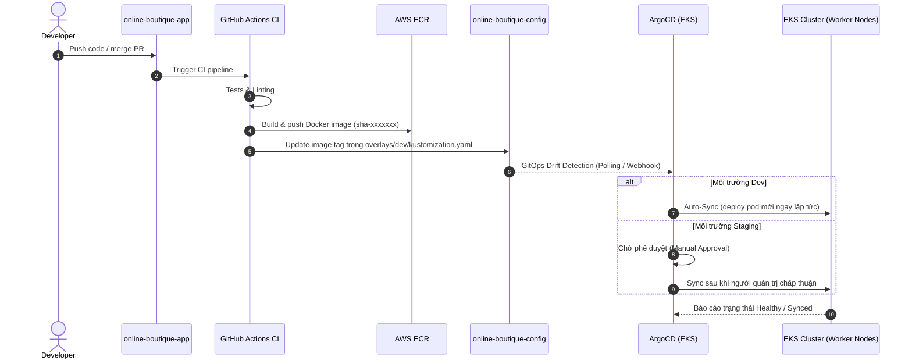

# 🚀 Stage 3 – CD Pipeline: ArgoCD + GitOps

> **Ngày hoàn thành:** 2026-10-17  
> **Áp dụng cho:** `online-boutique-app` và `online-boutique-config`  
> **Tác giả:** DevOps Team

---

## 1. Tổng Quan & Mục Tiêu

Stage 3 thiết lập quy trình Continuous Delivery (CD) theo mô hình **GitOps** với **ArgoCD** trên AWS EKS v1.36. Toàn bộ cấu hình deployment của hệ thống được tách biệt hoàn toàn khỏi mã nguồn ứng dụng và được quản lý tại repository riêng: `online-boutique-config`.

### 1.1 Luồng End-to-End GitOps



---

## 2. Các Quyết Định Thiết Kế Quan Trọng

### 2.1 Loại Bỏ ArgoCD Image Updater
- **Vấn đề ban đầu:** Kế hoạch gốc dự kiến cài đặt ArgoCD Image Updater để tự động thăm dò (polling) ECR và cập nhật tag.
- **Quyết định:** **Bỏ hoàn toàn ArgoCD Image Updater**.
- **Lý do:**
  1. Stage 2 CI đã có composite action `update-manifests` sử dụng `yq` trực tiếp commit tag `sha-<commit>` vào repo config. Nếu cả hai cơ chế cùng can thiệp vào `kustomization.yaml` sẽ gây race condition và xung đột Git.
  2. Cơ chế CI push-based đơn giản, minh bạch, đảm bảo tính bất biến (immutability) và truy vết (traceability) từ commit Git đến container image chạy thực tế.
  3. Tiết kiệm tài nguyên CPU/RAM cho worker nodes của EKS.

### 2.2 Tích Hợp AWS ElastiCache Redis Cho CartService
- **Dọn dẹp:** Xóa hoàn toàn Deployment và Service `redis-cart` trong base manifests.
- **Cấu hình:** Sử dụng Kustomize patch (`overlays/dev/patches/cartservice-redis.yaml`) để tiêm endpoint ElastiCache từ Terraform output vào biến môi trường `REDIS_ADDR` của `cartservice`:
  ```
  REDIS_ADDR = "online-boutique-dev.e9wc6a.ng.0001.apse1.cache.amazonaws.com:6379"
  ```
- **Lợi ích:** Đảm bảo dữ liệu giỏ hàng được quản lý bởi dịch vụ Redis Multi-AZ tiêu chuẩn doanh nghiệp của AWS, không lo mất dữ liệu khi pod khởi động lại.

### 2.3 Loại Bỏ ShoppingAssistantService Khỏi Manifests
- `shoppingassistantservice` phụ thuộc vào các dịch vụ Google Cloud (Gemini AI, AlloyDB, Google Secret Manager) và không có repository trên AWS ECR, nên đã được loại bỏ hoàn toàn khỏi manifest triển khai.

### 2.4 Quản Lý Hạ Tầng Bổ Trợ Bằng ArgoCD Helm Applications
- **AWS Load Balancer Controller:** Cài đặt qua ArgoCD trỏ đến chart `eks/aws-load-balancer-controller` version `1.12.*`, gắn IRSA role `online-boutique-dev-aws-lb-controller` để chuẩn bị cho Ingress ALB ở Stage 4.
- **Cluster Autoscaler:** Cài đặt qua ArgoCD trỏ đến chart `autoscaler/cluster-autoscaler` version `9.*`, gắn IRSA role `online-boutique-dev-cluster-autoscaler` để tự động mở rộng/thu hẹp Spot instance worker nodes.

---

## 3. Cấu Trúc Repository GitOps (`online-boutique-config`)

```
online-boutique-config/
├── README.md
├── argocd/
│   ├── install/
│   │   └── values.yaml               # Cấu hình Helm cho ArgoCD (insecure TLS, single replica, LoadBalancer)
│   └── apps/
│       ├── dev/
│       │   ├── online-boutique.yaml   # ArgoCD App: 11 microservices (Dev - Auto Sync)
│       │   ├── aws-lb-controller.yaml # ArgoCD App: AWS LB Controller (Auto Sync)
│       │   └── cluster-autoscaler.yaml# ArgoCD App: Cluster Autoscaler (Auto Sync)
│       └── staging/
│           └── online-boutique.yaml   # ArgoCD App: 11 microservices (Staging - Manual Sync)
├── base/
│   └── online-boutique/              # Base manifests sạch (11 microservices)
│       ├── kustomization.yaml
│       ├── namespace.yaml
│       ├── adservice.yaml
│       ├── cartservice.yaml           # Đã loại bỏ redis-cart
│       ├── checkoutservice.yaml
│       ├── currencyservice.yaml
│       ├── emailservice.yaml
│       ├── frontend.yaml
│       ├── loadgenerator.yaml
│       ├── paymentservice.yaml
│       ├── productcatalogservice.yaml
│       ├── recommendationservice.yaml
│       └── shippingservice.yaml
└── overlays/
    ├── dev/
    │   ├── kustomization.yaml         # Image tags (CI cập nhật) & patch references
    │   └── patches/
    │       └── cartservice-redis.yaml # Patch REDIS_ADDR -> ElastiCache dev endpoint
    └── staging/
        ├── kustomization.yaml
        └── patches/
            └── cartservice-redis.yaml # Patch REDIS_ADDR -> ElastiCache staging endpoint
```

---

## 4. Hướng Dẫn Cài Đặt & Vận Hành ArgoCD

### 4.1 Cài Đặt ArgoCD lên EKS Cluster

```bash
# 1. Thêm repo Helm của Argo
helm repo add argo https://argoproj.github.io/argo-helm
helm repo update argo

# 2. Cài đặt ArgoCD vào namespace 'argocd'
helm install argocd argo/argo-cd \
  --namespace argocd --create-namespace \
  -f argocd/install/values.yaml
```

### 4.2 Truy Cập Giao Diện ArgoCD Web UI
- **Loại Service:** LoadBalancer (AWS Network/Classic ELB)
- **Lấy URL truy cập ArgoCD:**
  - **Linux / macOS (Bash):**
    ```bash
    echo "http://$(kubectl -n argocd get svc argocd-server -o jsonpath='{.status.loadBalancer.ingress[0].hostname}')"
    ```
  - **Windows (PowerShell):**
    ```powershell
    "http://" + (kubectl -n argocd get svc argocd-server -o jsonpath="{.status.loadBalancer.ingress[0].hostname}")
    ```
- **Username:** `admin`
- **Lấy mật khẩu ban đầu:**
  - **Linux / macOS (Bash):**
    ```bash
    kubectl -n argocd get secret argocd-initial-admin-secret -o jsonpath="{.data.password}" | base64 -d
    ```
  - **Windows (PowerShell):**
    ```powershell
    [System.Text.Encoding]::UTF8.GetString([System.Convert]::FromBase64String((kubectl -n argocd get secret argocd-initial-admin-secret -o jsonpath="{.data.password}")))
    ```

### 4.3 Triển Khai Các Ứng Dụng (Applications)

```bash
# Triển khai bộ điều khiển hạ tầng
kubectl apply -f argocd/apps/dev/aws-lb-controller.yaml
kubectl apply -f argocd/apps/dev/cluster-autoscaler.yaml

# Triển khai 11 microservices ứng dụng Online Boutique
kubectl apply -f argocd/apps/dev/online-boutique.yaml
```

---

## 5. Kết Quả Triển Khai Thực Tế

### 5.1 Trạng Thái ArgoCD Applications
```
NAME                  SYNC STATUS   HEALTH STATUS
aws-lb-controller     Synced        Healthy
cluster-autoscaler    Synced        Healthy
online-boutique-dev   Synced        Healthy
```

### 5.2 Trạng Thái Pods Trong Namespace `online-boutique`
Tất cả 11/11 microservices đang chạy ổn định (1/1 Running):
- `adservice`
- `cartservice`
- `checkoutservice`
- `currencyservice`
- `emailservice`
- `frontend`
- `loadgenerator`
- `paymentservice`
- `productcatalogservice`
- `recommendationservice`
- `shippingservice`

### 5.3 Xác Nhận Tải Thực Tế (Load Generator & ElastiCache)
- `loadgenerator` gửi lưu lượng mô phỏng người dùng mua sắm liên tục vào `frontend`.
- Tỉ lệ lỗi tổng hợp: **0.00%** trên hàng nghìn requests.
- `cartservice` kết nối và thực hiện các thao tác thêm giỏ hàng (`AddItemAsync`), lấy giỏ hàng (`GetCartAsync`), xóa giỏ hàng (`EmptyCartAsync`) trực tiếp trên **AWS ElastiCache Redis** thành công.

### 5.4 Cổng Truy Cập Người Dùng (Frontend External Load Balancer)
- **Loại Service:** LoadBalancer (AWS Network Load Balancer được quản lý bởi AWS Load Balancer Controller)
- **Lấy URL truy cập ứng dụng Online Boutique:**
  - **Linux / macOS (Bash):**
    ```bash
    echo "http://$(kubectl -n online-boutique get svc frontend-external -o jsonpath='{.status.loadBalancer.ingress[0].hostname}')"
    ```
  - **Windows (PowerShell):**
    ```powershell
    "http://" + (kubectl -n online-boutique get svc frontend-external -o jsonpath="{.status.loadBalancer.ingress[0].hostname}")
    ```
- **Kiểm tra phản hồi HTTP:**
  - **Linux / macOS (Bash):**
    ```bash
    curl -s -I "http://$(kubectl -n online-boutique get svc frontend-external -o jsonpath='{.status.loadBalancer.ingress[0].hostname}')"
    ```
  - **Windows (PowerShell):**
    ```powershell
    curl.exe -s -I ("http://" + (kubectl -n online-boutique get svc frontend-external -o jsonpath="{.status.loadBalancer.ingress[0].hostname}"))
    ```
  *(Kỳ vọng: trả về `HTTP/1.1 200 OK` và kèm `Set-Cookie: shop_session-id=...`)*

---

## 6. Chiến Lược Rollback (Rollback Strategy)

Khi xảy ra sự cố trên môi trường production/dev, quy trình rollback được thực hiện theo 2 phương thức:

### Cách 1: Git Revert (Khuyến nghị theo chuẩn GitOps)
Vì Git là single source of truth, phương thức an toàn nhất là revert commit trong `online-boutique-config`:
```bash
cd online-boutique-config
git log -n 5 --oneline
git revert <commit-sha-loi>
git push origin main
```
ArgoCD sẽ nhận diện drift và tự động đồng bộ (auto-sync) đưa cluster về phiên bản trước đó.

### Cách 2: ArgoCD CLI / UI Rollback
Trong trường hợp khẩn cấp cần phục hồi tức thì:
```bash
# Xem danh sách lịch sử deployment
argocd app history online-boutique-dev

# Rollback về bản revision mong muốn (ví dụ ID 1)
argocd app rollback online-boutique-dev 1
```

---

## 7. Xử Lý Sự Cố (Troubleshooting Runbook)

| Hiện tượng | Nguyên nhân phổ biến | Cách khắc phục |
|------------|----------------------|----------------|
| **OutOfSync** | Có commit mới chưa sync hoặc sai cú pháp manifest | Kiểm tra `kubectl kustomize overlays/dev`. Kiểm tra Diff trên ArgoCD UI. |
| **Degraded** | Pod crashloop hoặc fail readiness probe | Chạy `kubectl describe pod -n online-boutique <pod>` và `kubectl logs <pod>`. |
| **ImagePullBackOff** | ECR chưa có image tag hoặc quyền node pull ECR lỗi | Kiểm tra `aws ecr list-images --repository-name online-boutique/<service>`. Đảm bảo EKS Node Group có IAM role quyền `AmazonEC2ContainerRegistryReadOnly`. |
| **Redis Connection Timeout** | Security Group chặn port 6379 giữa EKS nodes và ElastiCache | Kiểm tra Security Group của ElastiCache cho phép ingress TCP 6379 từ EKS Node SG. |
| **FailedBuildModel (0 match VPC and tags: [kubernetes.io/role/elb])** | VPC ID trong Helm values của AWS Load Balancer Controller (`aws-lb-controller.yaml`) không đúng với VPC thực tế của EKS, hoặc public subnet thiếu tag | Sửa `vpcId` trong `argocd/apps/dev/aws-lb-controller.yaml` về đúng ID của VPC cụm EKS (ví dụ `vpc-0d45fceb8cf9ac238`), apply lại Application và kiểm tra public subnets có tag `kubernetes.io/role/elb: 1`. |

