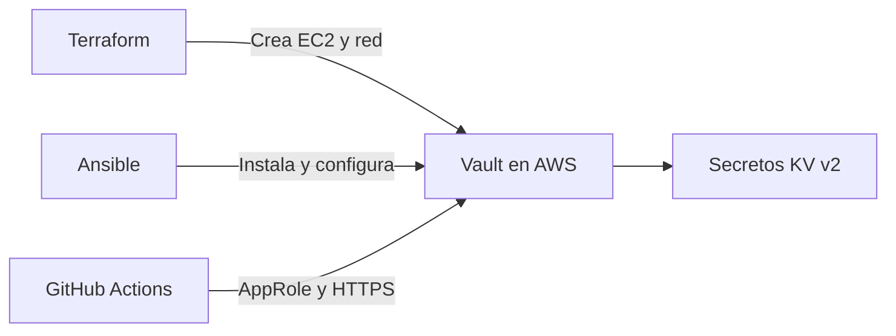

# Automatización de HashiCorp Vault con Ansible

## Objetivo

Como equipo, implementamos HashiCorp Vault en una instancia EC2 de AWS para administrar secretos de forma centralizada y evitar almacenarlos directamente en el repositorio o en los archivos del pipeline.

La infraestructura fue creada mediante Terraform, mientras que la instalación y configuración de Vault se automatizó utilizando Ansible.

## Arquitectura



## Archivos principales

- `ansible.cfg`: configuración general de Ansible.
- `inventory.example.ini`: plantilla del inventario sin información sensible.
- `playbooks/install-vault.yml`: instala Vault y configura su servicio.
- `playbooks/enable-vault-tls.yml`: crea los certificados y habilita HTTPS.
- `templates/vault.hcl.j2`: configuración inicial de Vault.
- `templates/vault-tls.hcl.j2`: configuración de Vault con TLS.
- `templates/vault-cert-ext.cnf.j2`: extensiones utilizadas para generar el certificado.
- `policies/github-actions-read.hcl`: política de acceso de solo lectura para GitHub Actions.

## Proceso realizado

1. Creamos la infraestructura de AWS mediante Terraform.
2. Configuramos el inventario local de Ansible.
3. Validamos la conexión SSH con la instancia EC2.
4. Instalamos y configuramos HashiCorp Vault con Ansible.
5. Inicializamos y desbloqueamos Vault.
6. Creamos un motor de secretos KV versión 2.
7. Configuramos una política con permisos mínimos.
8. Habilitamos AppRole para GitHub Actions.
9. Agregamos HTTPS mediante certificados TLS.
10. Integramos GitHub Actions con Vault.

## Comandos principales

```bash
cd infra/ansible-vault
ansible vault_servers -m ping
ansible-playbook playbooks/install-vault.yml
ansible-playbook playbooks/enable-vault-tls.yml
```

Para revisar la sintaxis sin modificar el servidor:

```bash
ansible-playbook playbooks/install-vault.yml --syntax-check
ansible-playbook playbooks/enable-vault-tls.yml --syntax-check
```

## Integración con GitHub Actions

El workflow `.github/workflows/vault-integration.yml` realiza automáticamente las siguientes actividades:

1. Configura las credenciales temporales de AWS.
2. Obtiene la IP pública del ejecutor.
3. Autoriza temporalmente el puerto `8200`.
4. Se autentica en Vault mediante AppRole.
5. Recupera únicamente el secreto autorizado.
6. Comprueba su existencia sin mostrar su valor.
7. Revoca el acceso temporal al finalizar.

## Configuración de GitHub

### Secretos

- `AWS_ACCESS_KEY_ID`
- `AWS_SECRET_ACCESS_KEY`
- `AWS_SESSION_TOKEN`
- `VAULT_ROLE_ID`
- `VAULT_SECRET_ID`
- `VAULT_CA_CERT`

### Variable

- `VAULT_ADDR`

## Medidas de seguridad

- Vault utiliza HTTPS.
- Las claves y tokens no se almacenan en Git.
- `inventory.ini`, archivos `.pem` y archivos de inicialización están incluidos en `.gitignore`.
- GitHub Actions utiliza una política de solo lectura.
- El puerto de Vault se abre únicamente para la IP temporal del ejecutor.
- La regla de acceso se elimina al terminar el workflow.
- Los valores recuperados desde Vault permanecen ocultos en los registros.

## Consideraciones del laboratorio

Las credenciales de AWS Learner Lab son temporales y deben actualizarse cuando cambia la sesión. Si la instancia se reinicia, Vault puede quedar sellado y será necesario desbloquearlo nuevamente.

La configuración de una sola clave de desbloqueo fue utilizada únicamente con fines académicos. En un ambiente productivo se deben utilizar varias claves o un servicio de auto-unseal.
